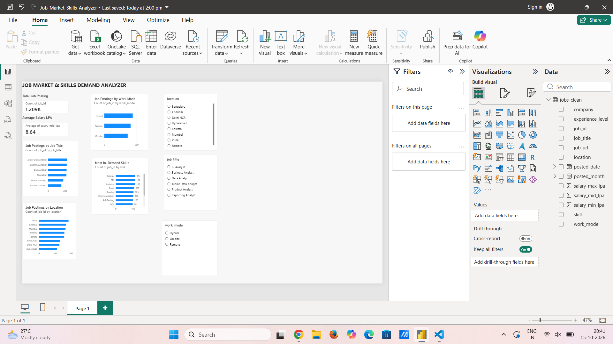

# Job Market & Skills Demand Analyzer

A beginner-friendly data analytics project using Python, SQL, and Power BI to explore job postings, salaries, locations, work modes, and in-demand skills.

## Dashboard Preview

## Tools Used
- Python (Pandas)
- SQL (SQLite)
- Power BI

## Key Features
- Total job postings and average salary overview
- Job title and location analysis
- Work mode analysis
- Most in-demand skills chart
- Interactive dashboard filters

## Project Files
- `job_market_analyzer_starter/` — Python scripts, dataset, SQL queries, and detailed README
- `Job_Market_Skills_Analyzer.pbix` — Power BI dashboard file
- `dashboard.png` — Dashboard screenshot

## Dataset Disclaimer
The dataset contains synthetic demonstration data for learning and portfolio practice. The results do not represent actual job-market statistics.

## Author
Aarshi Singh — MSc Computer Science Graduate
